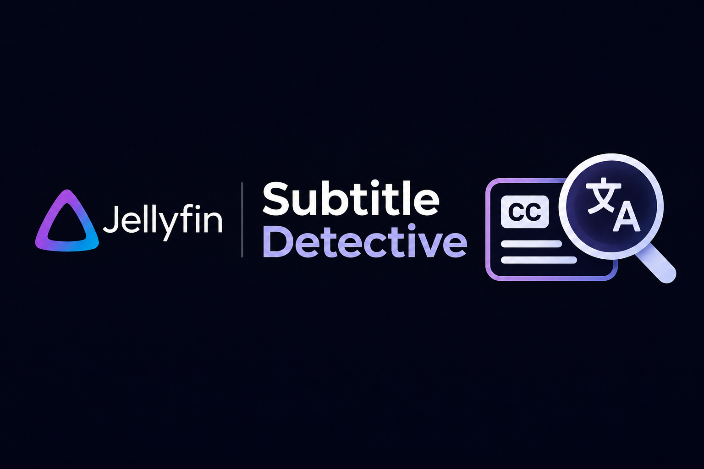

# Subtitle Detective

A native Jellyfin plugin for subtitle language detection, identification, and automatic naming.

## About This Project

I originally made Subtitle Detective for my own Jellyfin server because I was tired of dealing with incorrect subtitle languages, messy names, and inconsistent metadata.

I'm sharing it here in case anyone else has the same problem and finds it useful.

This is a personal project, developed primarily for my own needs. Updates and improvements will be made as needed.
## Before & After

| Before Subtitle Detective | After Subtitle Detective |
|:---:|:---:|
|  |  |

Subtitle Detective identifies subtitle languages and replaces inconsistent display names with clean, standardized labels without modifying the original media files.


## Installation

1. Open your Jellyfin Dashboard.
2. Navigate to **Plugins → Repositories**.
3. Add a new repository named **Subtitle Detective**.
4. Enter the following repository URL:

```
https://raw.githubusercontent.com/Sam031K/Subtitle-Detective/main/manifest.json
```

5. Open the plugin catalog.
6. Find Subtitle Detective and click **Install**.
7. Restart Jellyfin.


Future versions can be installed directly through Jellyfin using the same repository.

## Supported Libraries

Subtitle Detective is designed exclusively for subtitles in Movies and TV Shows libraries, including:

- Movies
- TV Shows
- Anime
- Anime Movies

Library eligibility is determined by Jellyfin's library type, not its name.

Music, Manga, Books, Audiobooks, and other unsupported library types are excluded.

## Automatic Detection & Scanning


Subtitle Detective analyzes embedded subtitle content instead of relying solely on existing language metadata.

- Text-based subtitles: SRT and ASS.
- Image-based subtitles: PGS and VobSub through OCR.
- Smart scanning to avoid unnecessary repeated analysis.
- Season-level supporting evidence.
- Automatic subtitle title cleanup.

## Automatic & Manual Approval


Subtitle corrections are automatically approved and applied when sufficient evidence supports the result.

When evidence is insufficient, conflicting, or inconclusive, the subtitle track is sent to the Review tab for manual approval.

Not every subtitle track will be automatically approved. Some manual intervention may be required.

## Subtitle Naming Convention

Subtitle Detective follows a consistent naming structure:

**Language – Qualifiers – Format**

Examples:

- English – Full Subtitles – ASS
- English – Signs and Songs – Default – ASS
- Turkish – Full Subtitles – SRT
- French – Forced – SRT
- English – SDH – PGS
- English – Commentary – ASS
- Japanese – ASS

Unnecessary release group names, redundant tags, and recognizable naming typos are cleaned up.

## Completed Results


Browse processed subtitle tracks, inspect previous results, and restore original subtitle names when necessary.

## Library Management


Browse movies, series, seasons, and individual episodes directly from Subtitle Detective without opening each title separately in Jellyfin.

## Non-Destructive Operation

Subtitle Detective works with Jellyfin's metadata.

- No remuxing.
- No modification of MKV files.
- No modification of video or audio tracks.
- No modification of original embedded subtitle content.
- Original subtitle names can be restored.

## Compatibility & Limitations

Currently tested on Linux x64 with Jellyfin 12.x, including TrueNAS.

Other platforms and library types have not been tested.

Language detection is not guaranteed to be perfect, particularly with short, multilingual, or unusual subtitle tracks.

## Credits & Acknowledgments

Thanks to the developers and contributors behind the open-source projects that helped make Subtitle Detective possible:

- [Subtitle OCR](https://github.com/IDisposable/jellyfin-plugin-subtitleocr)
- [Subtitle Edit](https://github.com/SubtitleEdit/subtitleedit)
- [Lingua .NET](https://github.com/searchpioneer/lingua-dotnet)
- [PaddleOCR](https://github.com/PaddlePaddle/PaddleOCR)
- [RapidOcrNet](https://github.com/BobLd/RapidOcrNet)
- [ONNX Runtime](https://github.com/microsoft/onnxruntime)
- [SkiaSharp](https://github.com/mono/SkiaSharp)

Third-party licensing information and notices are included in the release archives.


**Source Code:** The complete corresponding source code is available as a separate ZIP archive in the [Releases section](https://github.com/Sam031K/Subtitle-Detective/releases), alongside the compiled plugin.
Developed by Sam031K with AI-assisted development using ChatGPT and Codex.
